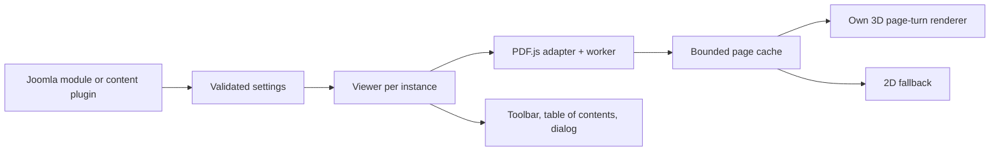

# PDF Book for Joomla 6: specification

Status: 2026-11-12. Target design based on the L2A behaviour analysis ([findings](../../research/legacy-flipbook/FINDINGS.md)). A browser prototype and a Joomla module package exist. [STATUS.md](STATUS.md) records what has actually been built and tested. This specification describes the full target.

## Goal and scope

The new flipbook replaces a previously used commercial flipbook module, with appearance and operation as close as practical. That means: choose a PDF, embed it in Joomla, turn pages like a book, zoom, and open it from a cover view. Security and maintainability are rebuilt from scratch. Defects, outdated browser workarounds and unescaped output of the legacy module are not compatibility goals.

The analysis follows L2A: understand behaviour, back findings with evidence, specify independently, then implement and compare. This is not a formal clean-room process, because the analyst read the supplied legacy source. No legacy code, brand images, icon font or audio file goes into the new product.

## Joomla integration

The legacy product is a site module. The planned replacement therefore consists of:

1. **`mod_pdfbook`** as the main integration: module positions, Joomla menu assignment, and embedding in existing content or page builders through the module mechanisms.
2. **`plg_content_pdfbook`** for convenient embedding in articles, with a narrowly defined syntax such as `{pdfbook src="images/brochure.pdf"}`. The syntax is a draft and gets its own parser with an allowlist of attributes.
3. A shared viewer with static resources under its own media path, bundled in one Joomla installation package.

PHP classes use namespaces, a service provider and a dispatcher or concrete plugin events. Resources are managed centrally through Joomla. There is no dependency on the legacy module or its global JavaScript variables. Module and plugin use the same configuration and the same viewer.

Architecture reference: [official Joomla 6 module example](https://github.com/joomla/Manual/blob/main/versioned_docs/version-6.0/building-extensions/modules/module-examples/basic-module.md).

## Intended feature set

| Area | Behaviour | Classification |
| --- | --- | --- |
| Embedded PDF | Book inside the page; configurable height and background | Core |
| Cover lightbox | One or more books with cover and optional title; click opens the viewer | Core |
| Page turning | Mouse, buttons, touch; curved pages and shadow in 3D | Core; visual comparison needed |
| Fallback | Works without WebGL; opening the plain PDF is an additional fallback | Core |
| Single/double page | Automatic and fixed modes; correct front and back cover | Core |
| Reading direction | Left to right and right to left | Feature parity |
| Navigation | Next/previous, first/last page, jump to page number | Core |
| Zoom and fullscreen | Sharp re-rendering, controlled reset, fullscreen only after user action | Core |
| Thumbnails | Rendered on demand; click navigates | Feature parity |
| Table of contents | PDF bookmarks, additional manual entries, defined precedence | Feature parity |
| PDF links | Internal targets and checked external links stay usable | Feature parity |
| Download | Button can be shown or hidden; this is not access protection | Feature parity |
| Sound and autoplay | Configurable; timers stop in a controlled way, audio only after browser permission | Feature parity |
| Interface | German/English texts; toolbar top or bottom, individual actions can be hidden | Feature parity |
| Image book | Ordered image list from an allowed media folder, exclusion list | After the PDF core, if existing use or full parity requires it |
| Wide PDF inner pages | Optional splitting of pre-assembled spreads; clear mapping to the original PDF page | Decide before migration using real documents |
| Link/button opens book | Optional trigger for the same dialog | Extension; a disabled demo path in the legacy back end |
| Text search | Not yet confirmed as a requirement | Not silently promised as a core feature |

Simply rotating a flat page does not prove the desired 3D parity. The prototype has to show curvature, shadow, binding, release while dragging and the page-change animation in a comparable way.

## Technical data flow

PDF.js parses and renders PDFs. Our own code handles page state, page turning, controls and the Joomla integration. The renderer receives finished page images and page sizes and knows nothing about Joomla. A graphics library is only chosen after a licence, maintenance and security review, and then pinned.

On 2026-11-11 the official release APIs listed [PDF.js 6.5.438](https://github.com/mozilla/pdf.js/releases/tag/v6.5.438) and [Joomla 6.2.0](https://github.com/joomla/joomla-cms/releases/tag/6.2.0). These are the development baseline, not yet a tested combination. The PDF.js API, worker and support resources must come from exactly the same release.

## Settings and migration

Legacy settings are described by their behaviour here. The exact mapping from legacy parameter names stays in the local analysis case.

| Legacy setting (described) | New meaning / handling |
| --- | --- |
| Layout: inline or gallery, plus a disabled demo layout | `inline` or `gallery`; do not migrate the disabled demo mode automatically |
| PDF source (local file or URL) | Validated source; by default a PDF from the site's own media area |
| Image folder and exclusion list | Image list limited to the allowed media area |
| List of several books | List of books with stable IDs, source, title and cover |
| 3D renderer on/off, shadow on/off | Renderer choice and shadow; working fallback |
| Page mode, single-page booklet mode, reading direction | Defined values; report invalid legacy data and fall back to safe defaults |
| Height, background, cover size | Typed, bounded values; no free style string |
| Page-turn duration | Duration in milliseconds; 800 ms as the first comparison default |
| Autoplay on/off and interval | Autoplay and interval separate; starting value from the actual module configuration |
| Sound on/off and sound file | Sound on/off; own sound or one with a verified suitable licence |
| Manual outline entries and "replace PDF outline" | Manual entries with validated page targets; explicit rule for adding or replacing |
| Hidden toolbar buttons, toolbar position, download on/off | Visibility and position; hiding is not access control |
| Interface texts | Language files and optional plain-text values |
| Custom CSS and custom JavaScript fields | Record individual customisations and re-implement them one by one; never import or execute them automatically |
| Load-jQuery and reload-prevention switches | Dropped; the new resource management handles loading |

The legacy manifest defines 56 fields; they are recorded in the local analysis case. A migration tool first reads the legacy values, writes a report and creates new, unpublished instances. Existing module IDs and article references only change during the targeted switch-over.

A site inventory dated 2026-09-12 lists five legacy instances, four of them published. It contains no PDF sources or parameters. Fresh parameters, embedding locations, access rights and menu assignments must be collected before migration.

## Implementation steps

1. **Record the reference:** read the actual settings and source version; document representative PDFs, screenshots and interaction flows.
2. **Check the technical core:** integrate the current PDF.js locally; own page-turn animation with a test PDF; examine large PDFs, fast page changes and WebGL failure.
3. **Develop the Joomla package:** native module structure, shared viewer, form fields, languages and content plugin; local installation and update test.
4. **Complete feature parity:** cover gallery, thumbnails, bookmarks, touch, zoom, dialog, narrow screens.
5. **Security and comparison tests:** requirements from `SECURITY.md`; documented browser and Joomla tests.
6. **Migration on a test copy:** map the new modules, compare affected pages, prove the way back to the previous state. Only then a targeted production switch-over.

## Functional acceptance

This list is the full target acceptance. Partial checks have been run; [STATUS.md](STATUS.md) records the individual status and limits.

- The same PDF shows the same page order and starts at the defined page; tests with 1, 2, odd and even page counts.
- Fast page turning and zooming show no stale renders or swapped pages.
- Two inline books and one gallery work together; events and resources stay per instance.
- The dialog closes with Escape, keeps focus and returns it to the trigger; rendering stops after closing.
- The layout stays usable on narrow screens, device changes and browser zoom; animation respects reduced motion.
- Documents with umlauts, embedded fonts, images, links and bookmarks work; CJK, passwords and forms are added according to the planned scope.
- Without WebGL and on load errors there is clear feedback and a usable alternative.
- Installation, update and uninstallation on the current Joomla 6 version, without the backward-compatibility plugin.
- The affected pages of the target site work with its existing template and page builder; the standard and blog template styles are checked separately.

The actual 3D geometry, the final library choice and measurable performance limits are set after the reference prototype. Full visual equality has not been demonstrated.
