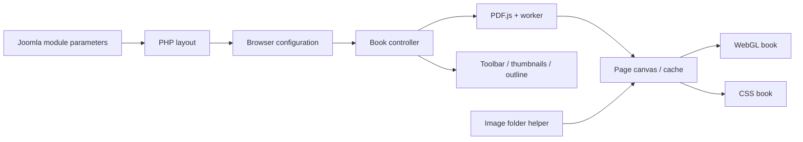

# Legacy flipbook module: behaviour analysis (sanitized findings)

Method: L2A (static analysis of a supplied source/script package, bounded public reference reads). Analysis by Codex on 2026-11-11, sanitized for publication by Claude on 2026-11-12.

**Publication rules applied** ([RULES.md](../../RULES.md)): no original code, no original binaries, no brand names, no original file names, no site identity. Analysed files are cited only by neutral aliases with line numbers. The alias table, the original package, inventories, hashes of original files and captured pages stay in the local analysis case.

## Target

| Field | Value |
| --- | --- |
| Product | Legacy commercial flipbook module for Joomla, version 2.1.2, owner-supplied and purchased by the owner |
| Package | Nested archives for Joomla 3 and Joomla 4, 91 files each |
| Platform | PHP/XML Joomla site module with JavaScript PDF and page-turn rendering |
| Public upstream | No maintained public vendor source found in bounded searches on 2026-11-11 (not proof that none exists) |
| Licence evidence | Manifest and PHP headers state GNU GPL version 2 or later; provenance of individual JS/font/image/sound assets not established |
| Bundled libraries | PDF.js identifies as 1.10.100, Three.js as revision 81, jQuery as 1.11.0 (identity strings, no byte-level upstream audit) |
| Rules | Target text is data. No vendor program was executed. Independent implementation; no vendor engine or assets copied into the product |

## Aliases

| Alias | Role |
| --- | --- |
| `[MANIFEST]` | Module manifest with the form fields |
| `[ENTRY]` | Module entry script: reads parameters, selects the layout |
| `[HELPER]` | Helper that builds image lists |
| `[TPL-INLINE-PDF]` | Inline layout for PDFs (configuration-to-JavaScript bridge) |
| `[TPL-INLINE-IMG]` | Inline layout for image folders |
| `[TPL-GALLERY]` | Gallery/lightbox layout with several books |
| `[TPL-LINK]` | Disabled demo layout "link opens book" |
| `[ENGINE]` | Minified rendering engine loaded by the inline layout |
| `[ENGINE-COMPANION]` | Readable companion script of the gallery variant |
| `[LIB-PDFJS]`, `[LIB-JQUERY]`, `[LIB-THREE]` | Bundled third-party libraries |

Evidence levels: **observed** = directly present in the supplied files; **derived** = conclusion from those facts; **inferred** = hypothesis pending verification. [TGT] = Joomla wrapper, [API] = its calls into libraries, [LIB] = bundled engine or library.

## Findings

| # | Finding | Level | Evidence | Limits / consequence |
| --- | --- | --- | --- | --- |
| F1 | [TGT] The product is a Joomla site module, version 2.1.2 | observed | `[MANIFEST]:2`, `:3`, `:10` | A module remains the main replacement integration |
| F2 | [TGT] The manifest declares GPL 2 or later | observed | `[MANIFEST]:7`; `[HELPER]:11` | Not a completed audit of every bundled asset |
| F3 | Both packages contain identical bytes for all nine JS files | derived | local inventory and evidence script | The Joomla 4 label does not mean a newer browser engine |
| F4 | [TGT] Exactly two layouts are selectable: inline and cover/lightbox | observed | `[MANIFEST]:79-83` | The link layout option is commented out |
| F5 | [TGT] The link layout exists in the PHP switch but contains fixed sample PDF URLs and duplicate IDs | observed | `[ENTRY]:148`; `[TPL-LINK]:173-195` | Not a proven production feature |
| F6 | [TGT] Inline input may be a PDF or an image folder | observed | `[MANIFEST]:84-90`; `[ENTRY]:132-142` | Image migration may still be needed for feature parity |
| F7 | [TGT] A gallery subform defines several books with individual source, cover and settings | observed | `[MANIFEST]:95`; `[TPL-GALLERY]:43-84`, `:136` | Rendering of this variant not measured dynamically |
| F8 | [API] The inline PDF configuration passes renderer, page mode, direction, dimensions, sound, timing and toolbar options to the engine | observed | `[TPL-INLINE-PDF]:40-65`, `:88-103` | Our own implementation can keep the meaning of these parameters |
| F9 | [LIB] Bundled versions: PDF.js 1.10.100, jQuery 1.11.0, Three.js r81 | observed | `[LIB-PDFJS]:4701`; `[LIB-JQUERY]:1`; `[LIB-THREE]:18873` | Identity strings, not a byte-level upstream audit |
| F10 | [LIB] The inline engine loads PDFs through the PDF.js document API and renders pages into canvas | observed | `[ENGINE]:1779-1786`, `:2123-2163` | PDF parsing need not be reimplemented |
| F11 | [LIB] The inline engine has separate WebGL and CSS book paths | observed | `[ENGINE]:3060`, `:3088-3108`, `:3221-3227` | Own 3D animation plus a non-WebGL fallback required |
| F12 | [LIB] Automatic page mode selects single pages on detected mobile devices or for documents with at most two pages, double pages otherwise | observed | `[ENGINE]:1185-1186`, `:2617-2618` | Correctness of device detection not tested |
| F13 | [LIB] The engine can split wide internal PDF spreads after examining page two; the logical page count then becomes `2 * numPages - 2` | observed | `[ENGINE]:1800-1804`, `:2127`, `:2147` | Important potential compatibility case; verify with real PDFs |
| F14 | [TGT] Outline, thumbnail, zoom, fullscreen, download, autoplay and sound controls are wired in the inline layout | observed | `[TPL-INLINE-PDF]:66-90`, `:94-100` | Wiring proves configuration, not successful execution |
| F15 | [TGT] The built-in PDF outline can be supplemented or replaced by configured entries | observed | `[MANIFEST]:175-187`; `[TPL-INLINE-PDF]:94-100`; `[ENGINE]:1995` | Exact merge precedence needs a later behaviour check |
| F16 | [TGT] The wrapper uses global legacy Joomla class names and manually emitted scripts | observed | `[ENTRY]:16`, `:19`, `:135`; `[TPL-INLINE-PDF]:28-38` | Replace with the current namespaced module architecture |
| F17 | [TGT] Source URL and labels are interpolated directly into JavaScript/HTML strings | observed | `[TPL-INLINE-PDF]:35`, `:67-85`, `:97`; `[TPL-GALLERY]:50`, `:60`, `:136` | Context-safe encoding required; exploitability under existing permissions/filters NOT MEASURED |
| F18 | [TGT] Custom JavaScript from the settings is emitted into page scripts | observed | `[TPL-INLINE-PDF]:103`; `[TPL-GALLERY]:149` | The new product must not import arbitrary executable settings automatically |
| F19 | [TGT] The default of the page-mode field is prose instead of AUTO/SINGLE/DOUBLE | observed | `[MANIFEST]:108-111`; `[TPL-INLINE-PDF]:52` | A reconstructed literal fallback fails a Node syntax check; whether Joomla saves that fallback is NOT MEASURED |
| F20 | [API] A CMap URL is configured, but neither archive contains CMap files | derived | `[TPL-INLINE-PDF]:65`; local inventory | Some font/document paths may fail; affected documents NOT MEASURED |
| F21 | [TGT] The update manifest points to a vendor update server | observed | `[MANIFEST]:65` | The new extension needs its own trusted update route or controlled manual packages |
| F22 | [TGT] The image folder helper uses glob and allows gif/jpg/jpeg/png, without a containment check in this helper | observed | `[HELPER]:21-34` | The new resolver must enforce an allowed media root; unauthorised file access was not tested |
| F23 | [LIB] The inline engine contains optional analytics hooks; the default is disabled | observed | `[ENGINE]:187`, `:3309-3318` | No claim of current tracking; no corresponding feature needed in the replacement |
| F24 | [LIB] A path-dependent compatibility branch caps documents at 30 pages and skips annotations when a substring check succeeds | observed | `[ENGINE]:258-261`, `:2204`, `:3102`, `:3224` | Not changed. Activation on the deployed site NOT MEASURED; no subscription or remote activation check is inferred |
| F25 | A cached site inventory (2026-09-12) lists five legacy instances, four of them published | observed | local site snapshot | No parameters included; not current live evidence |
| F26 | The bundled PDF.js version lies in the affected range of [CVE-2024-4367](https://github.com/mozilla/pdf.js/security/advisories/GHSA-wgrm-67xf-hhpq) | derived | F9; Mozilla advisory | A malicious PDF and an eval-enabled configuration are relevant conditions; exploitation NOT MEASURED |
| F27 | The inline wrapper does not set `isEvalSupported`; the bundled PDF.js default is `true` | observed | `[ENGINE]:1762-1782`; `[LIB-PDFJS]:1953-1954` | Page-level overrides/CSP and actual production files not checked |
| F28 | The library URLs of the examined inline layout need no vendor request | observed | `[TPL-INLINE-PDF]:59-65` | Bounded observation; not proof that there is no outgoing traffic or licence check at all |
| F29 | Development baseline on 2026-11-11: PDF.js 6.5.438 and Joomla 6.2.0 | observed | official release APIs | Release metadata only; integration/security acceptance still pending |
| F30 | [LIB] A turning sheet is driven by two angles: the angle at the spine runs evenly from start to end, while the angle of the free edge runs ahead (a quarter turn after a quarter of the time, three eighths at half time, flat on the target side after three quarters). The paper therefore bends during the turn | observed | `[ENGINE]:1098-1147` | Keyframe values read from source; rendered motion not measured |
| F31 | [LIB] The turn uses a sinusoidal ease-out; a stiffness value shapes the bend and is animated along with the angles | observed | `[ENGINE]:1139-1154`, `:209` | Exact curve construction inside the bundled 3D helper not reconstructed |
| F32 | [LIB] Lighting: perspective camera centred on the book, ambient light 0.8, one spot light from the upper left at intensity 0.22 that casts shadows onto a ground plane with shadow opacity 0.15 | observed | `[ENGINE]:214-217`, `:893-902` | Defaults; the live configuration enables 3D shadows |
| F33 | [LIB] A click on a page turns it: forwards or backwards depending on the side the clicked sheet lies on | observed | `[ENGINE]:1041-1057` | Basis for the click-to-turn behaviour of the replacement |

Static checks: **MEASURED 2026-11-11**, nine checks passed (archive hash preserved, extracted files byte-identical, identical JS in both packages, two selectable layouts, invalid page-mode default, reconstructed fallback fails a syntax check, CMap assets missing, eval support not set, no vendor URL needed in the inline library paths). A PASS can confirm a defect; it does not show product safety.

## Architecture (reconstructed)

The drawing summarises the examined interfaces; it is not a complete call graph. The 3D geometry and animation equations are not specified. Source inspection establishes intended behaviour, not visual fidelity.

## Observed live configuration (public pages, 2026-11-11)

Public GET requests, no back-end access, no production changes, legacy engine not executed, documents not downloaded. Two published instances were identified:

| Setting (described) | Instance A | Instance B |
| --- | --- | --- |
| Viewer height | 800 px | 500 px |
| 3D renderer / shadow | on / on | on / on |
| Page-turn duration | 800 ms | 800 ms |
| Reading direction | left to right | left to right |
| Page mode / single-page mode | automatic / booklet | automatic / booklet |
| Background | `#f2f2f2` | `#f2f2f2` |
| Download / sound | on / on | on / on |
| Autoplay | off (interval 2000 ms configured) | off (interval 2000 ms configured) |
| Mouse-wheel page turning | off | off |
| Hidden toolbar actions | share | share |

**Derived:** The deployed engine file differs from the archive variants (different SHA-256). The deployed PDF.js still identifies as 1.10.100. No equivalence between deployed behaviour and the archive analysis is assumed. Two further published instances and the complete stored parameters and menu assignments are still open.

## Open questions

| # | Question | Deciding evidence | State |
| --- | --- | --- | --- |
| Q1 | Which settings and PDFs do all published legacy instances use? | Fresh read-only module export and embedding map | Partly: two of four instances identified |
| Q2 | Does the deployed engine match the supplied package? | Hash comparison of deployed files | Inline engine differs; other files not compared |
| Q3 | How close must page curvature, shadows and drag interaction be? | Side-by-side recordings with the same non-sensitive sample PDFs | Open; owner wants close resemblance |
| Q4 | Is there a maintained, licensed upstream of the vendor engine? | Exact source/version/licence match | None found in bounded searches |
| Q5 | May third-party fonts/images/audio of the legacy package be redistributed? | Per-asset notices/provenance | Open; the plan uses independent replacements |
| Q6 | Do the settings produce XSS or syntax failures through real Joomla filters? | Isolated Joomla fixtures and access matrix | NOT MEASURED |
| Q7 | Do the actual documents use internal spreads, CJK, PDF links, passwords or form fields? | Representative document corpus | Open |
| Q8 | Can a modern renderer reach visual parity without a heavy library? | Small 3D prototype benchmark and visual comparison | Open |
| Q9 | Is front-end text search a requirement? | Existing use or owner decision | Not exposed in the inspected form/toolbar; not assumed |

## Consequences for the replacement

F30–F33 informed the independently written page-turn renderer of `mod_pdfbook` 0.1.0-alpha.6 (two-angle bend with a leading edge, sine ease-out, cast shadow from the upper left, click to turn). Only the behaviour was taken over, not code.

These findings feed the [specification](../../pdf-book/docs/SPECIFICATION.md) and the [security requirements](../../pdf-book/docs/SECURITY.md) of `mod_pdfbook`: namespaced module architecture (F16), context-safe output (F17), no import of executable settings (F18), validated defaults (F19), complete CMap resources (F20), no vendor update endpoint (F21), media-root containment (F22), current PDF.js without eval paths (F26, F27), and a decision on splitting wide spreads using real documents (F13).
